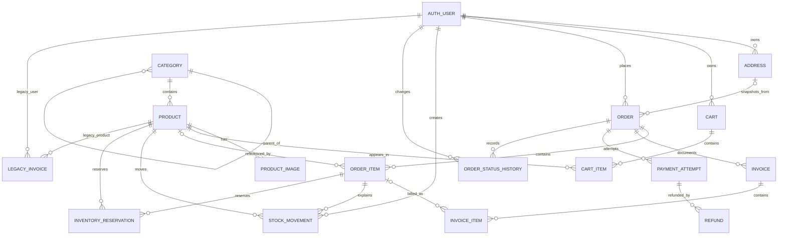

# LogixShop Database Architecture

Status: implemented database-layer proposal for the existing PostgreSQL development database. This document distinguishes verified repository/database facts from deliberate design boundaries.

## Architecture decisions

- The active identity remains Django's built-in `auth.User`. `AUTH_USER_MODEL` is not changed.
- The physical `shop_customer` table is retained as legacy data only; there is no active `Customer` model. New carts, orders, addresses, payments, and inventory records reference `auth.User`.
- The original single-product invoice table was renamed to `LegacyInvoice`/`shop_legacyinvoice` without deleting records. Its active foreign key now points to `auth.User`; a new `Invoice` table represents financial documents.
- Money is stored as integer Toman amounts with `currency='TOMAN'` defaults.
- PostgreSQL constraints enforce local invariants. Cross-row operations such as checkout, stock reservation, refunds, and status transitions still require transactional services; those services are intentionally outside this database-layer task.
- Provider/provider-product and product variants were not added: the repository has no provider/import-source or variant requirements. Adding either without evidence would be speculative.

## Existing data and migration result

Verified before migration:

- PostgreSQL already contained 5 categories, 5 products, 2 legacy customers, 0 legacy invoices, and 1 Django admin user.
- Existing `0011_category_slug_alter_category_title_and_more` was present in the working tree and already applied. It was not modified.
- The built-in `auth_user` table and migration graph were preserved.

Implemented migrations:

- `0012_rename_invoice_to_legacyinvoice.py`: data-preserving table/model rename plus protective legacy foreign keys.
- `0013_domain_models.py`: new domain tables, catalog fields, constraints, indexes, product-price normalization (`0` discount to `NULL`), and five legacy product-image gallery rows.
- `0014_legacyinvoice_user_fk.py`: guarded migration of the legacy invoice owner column to `auth.User`; it refuses to guess mappings if legacy invoice rows exist.
- `0015_remove_customer_state.py`: removes the deleted `Customer` model from Django's active state without dropping the physical legacy table.

Post-migration counts:

| Table | Rows |
| --- | ---: |
| `auth_user` | 1 |
| `shop_customer` | 2 |
| `shop_legacyinvoice` | 0 |
| `shop_category` | 5 |
| `shop_product` | 5 |
| `shop_productimage` | 5 |
| New cart/order/payment/inventory tables | 0 |

The existing legacy records and product/category relationships were preserved. No application workflow was implemented.

## Tables and responsibilities

### Identity and catalog

- `auth_user`: Django's current authentication identity. No custom user swap was attempted because the existing migration graph and populated `auth_user` table make an in-place swap unsafe.
- `shop_customer`: legacy physical table, including the existing plaintext password field. It is no longer represented by an active Django model, must not be used for new authentication, and passwords must not be copied into Django auth.
- `shop_category`: hierarchical catalog categories with nullable `parent_id`, unique nullable slug, soft-delete timestamp, ordering, and timestamps. Product deletion is protected by `PROTECT`; hierarchy-cycle prevention is model validation and must also be respected by admin/services.
- `shop_product`: catalog product, current price/discount, stock, rating/rating count, publication status, soft-delete timestamp, category, and legacy single-image field. `discounted_price=NULL` means no discount; `is_sale` and `has_stock` remain legacy compatibility fields and should not drive new workflows.
- `shop_productimage`: multiple product images with one conditional primary-image constraint. Existing `Product.image` values were copied as primary gallery rows; the old field remains for compatibility.

### Customer-owned commerce data

- `shop_address`: saved user addresses, recipient details, canonical country/phone fields as supplied by the application, coordinates, and one conditional default address per user. The model enforces a maximum of three addresses under a row lock; address edits must not change order snapshots.
- `shop_cart`: user-owned persistent carts with `ACTIVE`, `CONVERTED`, and `ABANDONED` states. One active cart per user is enforced conditionally. Guest carts remain session-only by design.
- `shop_cartitem`: one row per cart/product with positive quantity.
- `shop_order`: permanent multi-product purchase header, user ownership, optional saved-address reference, buyer/recipient/shipping snapshots, integer Toman totals, order status, payment status, and lifecycle timestamps.
- `shop_orderitem`: order lines with nullable product reference and immutable product/title/price/quantity snapshots.

### Financial and payment records

- `shop_invoice`: financial document linked to an order; supports `STANDARD` and `CREDIT_NOTE`, correction linkage, `DRAFT`/`ISSUED`/`VOID`, seller/buyer snapshots, and integer Toman totals.
- `shop_invoiceitem`: independent invoice lines with quantity, prices, discount, tax, and line-total snapshots.
- `shop_paymentattempt`: independent gateway attempts with status, gateway-scoped authority/reference uniqueness, and unique idempotency keys.
- `shop_refund`: independent refund attempts with unique idempotency keys and provider reference uniqueness. The aggregate-refund limit is service-level validation.

### Inventory and audit

- `shop_stockmovement`: non-zero inventory ledger entries with movement type, optional order-item/user links, and idempotency key.
- `shop_inventoryreservation`: temporary order-item/product reservations with positive quantity and at most one active reservation per order item.
- `shop_orderstatushistory`: append-only transition records while `Order.status` remains the query-time source of truth.

## ERD

`AUTH_USER` and `LEGACY_INVOICE` represent the active authentication/compatibility boundary. The physical `shop_customer` table remains only for preservation and is not used by current models.

## Field and constraint summary

All new primary keys use PostgreSQL-backed `BigAutoField`. All monetary fields are `BigIntegerField` Toman amounts.

- `Address`: `user` (`PROTECT`), title, recipient name/phone, country/province/city/district, street/building/unit/postal fields, nullable latitude/longitude, default flag, timestamps. Conditional unique `(user WHERE is_default)`; user address count is transactional model/service validation.
- `Category`: title unique, nullable unique slug, nullable description, protected self-parent, display order, timestamps, nullable `deleted_at`. Active-category queries must filter `deleted_at IS NULL`.
- `Product`: title, nullable unique slug, description, protected category, price, nullable discounted price, legacy sale/stock flags, non-negative stock, rating 0–5, non-negative rating count, `DRAFT/PUBLISHED/ARCHIVED`, image, timestamps, nullable `deleted_at`. Constraints enforce non-negative price/stock, valid discount range, and rating range.
- `ProductImage`: product, image, nullable alt text, non-negative sort order, primary flag, timestamp. Conditional unique primary image per product.
- `Cart`: user, `ACTIVE/CONVERTED/ABANDONED`, timestamps. Conditional unique active cart per user.
- `CartItem`: cart, product, positive quantity, timestamps. Unique `(cart, product)`.
- `Order`: unique public order number, user, nullable `SET_NULL` address, buyer/recipient/shipping snapshots, non-negative subtotal/discount/shipping/tax/total, currency, order status, payment status, notes, payment/cancellation/completion timestamps.
- `OrderItem`: order, nullable `SET_NULL` product, title/SKU/external-id snapshots, original/current unit prices, discount, positive quantity, line total, timestamp. Financial arithmetic reconciliation remains service-level.
- `Invoice`: order, unique invoice number, document type, optional protected correction link, document status, issue time, seller/buyer/billing snapshots, non-negative totals, currency, notes, timestamps.
- `InvoiceItem`: invoice, optional order-item link, description, positive quantity, prices/discount/tax/line-total fields, timestamp. Line reconciliation remains service-level.
- `PaymentAttempt`: protected order, gateway, non-negative amount, currency, status, nullable authority/reference, unique idempotency key, failure fields, request/verification/update timestamps. Gateway-scoped authority/reference uniqueness is conditional on non-null values.
- `Refund`: protected payment attempt, positive amount, currency, status, nullable unique provider refund ID, unique idempotency key, reason and timestamps. Total-refunded <= successful-payment validation remains transactional service logic.
- `StockMovement`: protected product, non-zero delta, movement type, optional order item/creator, unique idempotency key, note, timestamp. Product stock update and ledger insertion must be one service transaction.
- `InventoryReservation`: protected order item/product, positive quantity, reservation status, expiry/consumed/released timestamps. Conditional unique active reservation per order item.
- `OrderStatusHistory`: order, nullable previous status, new status, optional actor, note, timestamp. It is audit history, not the current-state source.

## Status and service-level rules

- Cart: only one `ACTIVE` cart per user; guest session carts are merged by a future checkout service with stock revalidation.
- Order: `PENDING -> CONFIRMED -> PROCESSING -> COMPLETED`; cancellation is explicit and must not rewrite payment history.
- Payment: attempts are independent; retries create new attempts; callbacks are idempotent and server-authoritative.
- Inventory: reservations reduce available-to-sell stock temporarily; successful payment consumes a reservation and creates a sale movement; failure/expiry releases it. These operations require `transaction.atomic()` and row locking.
- Issued invoices are historical documents. Corrections use credit notes linked to the original; they are not silent edits.
- Product/category soft deletion preserves order and invoice snapshots. Hard deletion is not part of normal store operations.

## Authentication migration strategy

The repository has an applied built-in auth migration graph and a populated `auth_user` table. It also has an independent physical legacy customer table with a plaintext password field. Replacing the user model now would require a staged migration involving auth permissions, sessions, admin logs, foreign keys, superuser preservation, and legacy-account mapping. That work was not safe to fold into this model migration.

Therefore:

1. Keep built-in `auth.User` as the only active user entity.
2. Do not copy legacy passwords.
3. Do not use the legacy customer table for new authentication or commerce ownership.
4. If email/phone login and verified identities are required, plan a separately approved user migration or authentication extension after an explicit account-mapping design.

## Tests and verification

Added focused tests in `shop/tests.py` for:

- three-address limit and one default address;
- category hierarchy cycle validation;
- one active cart and unique cart lines;
- one primary product image;
- order-item product snapshot stability;
- payment idempotency and positive refunds;
- non-zero stock movements and positive reservations.

Result: 7 tests passed against PostgreSQL. Django system checks passed, `makemigrations --check` reported no pending model changes, all migrations through `0015_remove_customer_state` are applied, PostgreSQL admin smoke tests returned HTTP 200 for the new models, and existing foreign-key checks returned zero orphans.

## Remaining decisions and next commands

Still requiring explicit product/business input:

- Provider meaning and relationship: supplier, external catalog source, or both.
- Whether product variants affect independent stock/pricing.
- Canonical phone normalization and verified email/phone authentication.
- Exact order/payment transition policy and when stock is reserved/consumed.
- Tax/invoice legal requirements and invoice issuance timing.
- Whether a webhook-event table is needed for a future real gateway.

Next implementation step should add transactional services and tests for cart merging, checkout snapshots, row-locked stock reservations, payment retries/callback idempotency, refund limits, and order-status transitions. No payment gateway or complete checkout workflow was added here.
